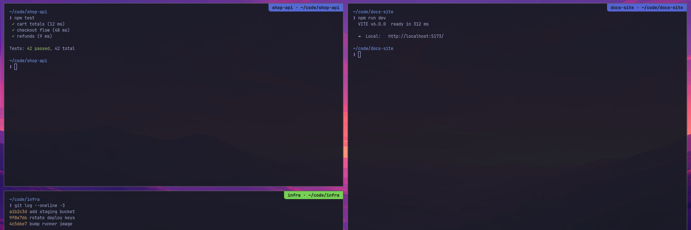
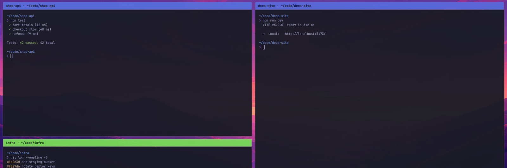

# Terminal labels

An Omarchy plugin that puts a name on your terminal windows. With several
AI coding sessions open, tiles get shuffled around and every terminal looks
the same. Give each one a label and it carries a coloured tag that moves with
the window.



Each label gets its own colour, so `shop-api` stays blue wherever its window
ends up. Labels can be set by hand, from a key, or automatically from the
project folder whenever Claude Code starts.

## Install

```sh
omarchy plugin add https://github.com/Nejcc/omarchy-term-labels.git --enable
ln -s ~/.config/omarchy/plugins/nejcc.term-labels/bin/tlabel ~/.local/bin/tlabel
```

For the rename key, add this line at the end of `~/.config/hypr/bindings.lua`:

```lua
-- Terminal labels: SUPER + ALT + N
pcall(dofile, os.getenv("HOME") .. "/.config/omarchy/plugins/nejcc.term-labels/term-labels.lua")
```

## Use

| What | How |
|---|---|
| Label this terminal | `tlabel api server` (run it inside the terminal) |
| Remove its label | `tlabel` |
| Rename the focused window (any app) | `SUPER + ALT + N`, type a name; `-` removes it, Esc cancels |

`tlabel` finds its own terminal window through the process tree, so it labels
the right window even if focus has moved.

### Label Claude Code sessions automatically

Add a `SessionStart` hook to `~/.claude/settings.json`:

```json
{
  "hooks": {
    "SessionStart": [
      {
        "matcher": "startup|resume",
        "hooks": [
          {
            "type": "command",
            "command": "$HOME/.config/omarchy/plugins/nejcc.term-labels/bin/claude-label",
            "timeout": 5
          }
        ]
      }
    ]
  }
}
```

Every new or resumed session then labels its terminal after the project: the
git repo name, or the folder name outside a repo. The last label set wins, so
`tlabel` or `SUPER + ALT + N` overrides it until the next session starts.

## Styles



| `style` | Looks like |
|---|---|
| `ribbon` (default) | A tag in a corner of the window |
| `bar` | A strip across the full window width, drawn over its top or bottom line |
| `group` | A strip above the window; the window shrinks to make room, so nothing is covered |

`group` uses Hyprland's own groupbar for the room: each labelled window
becomes a group of one, and the label is painted over the groupbar. While
this style is on, `group:auto_group` is off, or a window opened from a
labelled terminal would join its group. Switching to another style dissolves
the groups the plugin made and restores `auto_group`. Groups you made
yourself are left alone.

## Options

Set them on the plugin's entry in `~/.config/omarchy/shell.json`. Saving the
file applies them straight away.

```json
{
  "id": "nejcc.term-labels",
  "style": "ribbon",
  "position": "top-right",
  "color": "auto",
  "textColor": "auto",
  "fontSize": 12,
  "margin": 0,
  "opacity": 0.95,
  "autoLabel": "repo+path"
}
```

| Option | Values |
|---|---|
| `style` | `ribbon`, `bar`, `group` |
| `position` | `top-left`, `top-center`, `top-right`, `bottom-left`, `bottom-center`, `bottom-right`. For `bar` and `group` the second half places the text in the strip. |
| `color` | `auto` (a colour per label), `accent` (the theme's accent) or `#rrggbb` |
| `textColor` | `auto` or `#rrggbb` |
| `fontSize` | Pixels |
| `margin` | `ribbon` only: gap from the window edges. `0` sits flush in the corner. |
| `opacity` | `0` to `1` |
| `autoLabel` | What the Claude Code hook writes: `repo+path` (`shop-api · ~/code/shop-api`), `repo` or `path` |

## Adding a style

Each look is one file in `styles/`. A style gets `host` (the window's
rectangle), `label`, `options`, `fill` and `ink`, and draws itself relative to
`host`. Register it in the `styles` map in `Service.qml`.

## Files

- `~/.local/state/term-labels.json`: labels by window address. Labels of
  closed windows are dropped the next time `tlabel` runs.

## Known limits

- A mouse-drag resize sends Hyprland no event, so the label catches up on the
  next one.
- Labels are hidden under fullscreen windows.
- If the shell crashes while `group` is on, `auto_group` stays off until
  `hyprctl reload`.

## Requirements

Omarchy with Hyprland 0.55 or newer (Lua config), plus `jq`.
